# Metrics Pack — AI Notes: Personal Learning Notes

**Người thực hiện:** Trần Vũ Gia Huy · **MHV:** 2A202602705  
**Phạm vi:** một use case của Option B — learner chọn dấu vết học tập, AI hỗ trợ tổ chức, learner duyệt từng phần rồi lưu note.

> **Ranh giới bằng chứng:** Prototype Lab 18 cho thấy 2/2 tester chọn Option B vì trực quan và hỗ trợ tổ chức nội dung. Mẫu này nhỏ, chưa chứng minh retention hay khả năng tìm lại sau nhiều ngày. Các cadence, threshold và window dưới đây là giả định đo lường ban đầu, cần hiệu chỉnh bằng telemetry.

## 00 — Dự án, persona, core job

| Mục | Quyết định |
| --- | --- |
| Dự án | **AI Notes — Personal Learning Notes**, một trải nghiệm hỗ trợ learner biến dấu vết trong quá trình học thành ghi chú có cấu trúc và còn đường dẫn về nguồn. |
| Persona | **Learner đang học hoặc research thường xuyên**, có đánh dấu câu hỏi, điểm chưa hiểu hoặc ghi chú trong lúc học và muốn dùng lại kiến thức về sau. Chỉ phân tích persona learner. |
| Core job | “Khi vừa học hoặc research xong, tôi muốn giữ lại những phần quan trọng cùng ngữ cảnh để có thể tìm và dùng lại mà không phải đọc hoặc research lại từ đầu.” |

**Không nằm trong phạm vi:** instructor, cộng tác nhóm, chia sẻ công khai, tạo note hoàn toàn tự động và đo toàn bộ nền tảng học tập.

---

## 01 — Core Action

### Phân biệt bốn khái niệm

| Khái niệm | Định nghĩa trong AI Notes |
| --- | --- |
| Core job | Giữ và tìm lại phần kiến thức quan trọng cùng ngữ cảnh để dùng tiếp. |
| Core action | Learner **duyệt và lưu một learning note được tổ chức từ các dấu vết đã chọn**. |
| Core value | Có một bản ghi chú do mình kiểm soát, đủ ngữ cảnh, có thể quay về nguồn và dùng lại. |
| Core value event | `learning_note_saved` với `review_status=completed`, có ít nhất 2 dấu vết hợp lệ và ít nhất 1 liên kết nguồn. |

Core action không phải “bấm Tạo ghi chú” hay output AI. AI dựng cấu trúc mới chỉ là output; value chỉ được ghi nhận sau khi learner đã duyệt và chủ động lưu.

### Core Action Card

| Thành phần | Câu trả lời |
| --- | --- |
| Target user | Learner học/research thường xuyên và đã tạo ít nhất một dấu vết học tập trong nội dung đang học. |
| Core job | Giữ phần kiến thức quan trọng cùng ngữ cảnh để tìm và dùng lại về sau. |
| Core action | Duyệt và lưu một learning note được tổ chức từ các dấu vết learner đã chọn. |
| Object | Một `learning_note` gắn với một `learning_item` và các `evidence_id` nguồn. |
| Preconditions | Có learning item; có ít nhất một dấu vết hoặc nội dung learner tự viết; hệ thống tạo cấu trúc hoặc learner tự tổ chức; màn review hiển thị nội dung và nguồn. |
| Completion rule | Learner đã xử lý tất cả section bắt buộc, bấm **Lưu ghi chú**, server lưu thành công phiên bản note và trả về `note_id`. Với **qualifying note** dùng cho metric chính: có ≥2 dấu vết hợp lệ và ≥1 source link. |
| Core value | Learner có note đã kiểm soát, giữ được ngữ cảnh và đường về nguồn thay vì chỉ nhận một bản AI sinh tự động. |
| Evidence of value | Note tồn tại trong thư viện, mở lại được, giữ các phần learner đã duyệt và liên kết đúng về nguồn. Dấu hiệu mạnh hơn về value dài hạn là một lần `note_retrieved` sau đó. |
| Candidate event | `learning_note_saved`; event chất lượng sau đó: `note_retrieved`. |

### Tự kiểm 5 tiêu chí

| Tiêu chí | Kết quả | Lý do |
| --- | --- | --- |
| Gần core value | ✅ | Sau action, learner sở hữu note đã duyệt và còn ngữ cảnh nguồn. |
| Có thể lặp lại | ✅ | Nhu cầu lặp theo learning item/chủ đề mới, không cần ép thành thói quen hằng ngày. |
| Có thể quan sát | ✅ | Hoàn tất tại lần server lưu note thành công sau review; có `note_id` và trạng thái rõ ràng. |
| Có ý nghĩa | ✅ | Nhiều qualifying note hơn thể hiện nhiều đơn vị kiến thức đã được learner xử lý; vẫn cần counter-metric để chống lưu cho đủ số. |
| Có thể tác động | ✅ | Team có thể cải thiện chọn dấu vết, cấu trúc AI, review flow, độ tin cậy và khả năng quay về nguồn. |

**Gate 1: Đạt 5/5.** Action có actor, object và completion rule; không đồng nhất “hỏi AI” hoặc “AI tạo bản nháp” với value.

---

## 02 — Action Nature Card và cadence

| Thành phần | Phân tích |
| --- | --- |
| Actor | Một learner; account-level metric chỉ tổng hợp từ hành vi của learner này. |
| Intent | Kết thúc một lượt học/research với một phần kiến thức đủ quan trọng để giữ và dùng lại. |
| Trigger | Chủ yếu do **sự kiện tự nhiên bên ngoài sản phẩm**: hoàn thành một bài/chủ đề, gặp nội dung cần nhớ, hoặc cần khép lại một nhánh research. Notification không phải reason to return. |
| Effort | Khoảng vài phút để chọn phạm vi, xem cấu trúc, sửa/bỏ/chuyển dấu vết, duyệt section và lưu. Cần sự chú ý vì learner chịu trách nhiệm về nội dung cuối. |
| Value timing | Value ban đầu xuất hiện ngay khi có note đã duyệt và lưu; value mạnh hơn xuất hiện trễ khi learner tìm và dùng lại note. |
| State | Note, phiên bản, section đã duyệt, danh sách evidence, liên kết nguồn, learning item và thời điểm lưu được giữ lại. |
| Dependency | Phụ thuộc learner đã có nội dung/dấu vết đủ ý nghĩa; phụ thuộc AI tổ chức được nhưng luôn có lối tự viết; không phụ thuộc thành viên khác hay approval. |
| Repeat condition | Learner hoàn thành một learning item/chủ đề mới và lại có kiến thức muốn giữ; hoặc một nhu cầu mới khiến họ mở note cũ để dùng lại. |

### Kết luận cadence

- **Dạng hành vi:** tiến trình tích lũy, kích hoạt theo sự kiện học tập.
- **Kết luận theo template:** Đối với **learner đang học hoặc research thường xuyên**, core action **duyệt và lưu một learning note từ dấu vết đã chọn** thường xuất hiện **sau một learning item/chủ đề có nội dung đáng giữ, ước tính vài lần mỗi tuần trong giai đoạn học tích cực**, vì **mỗi lần học tạo ra một đơn vị kiến thức mới còn nhu cầu giữ phụ thuộc lịch học thực tế**. Do đó, nhịp đo phù hợp là **theo learning cycle, tổng hợp theo tuần** ở cấp **learner**.

Tăng frequency không luôn đồng nghĩa value tăng: một note tốt có thể gom trọn một chủ đề, còn nhiều note vụn có thể làm retrieval tệ hơn.

**Gate 2: Đạt.** Cadence xuất phát từ learning cycle và trigger tự nhiên, không từ thói quen chọn DAU/WAU.

---

## 03 — Metric System

### 3.1 Activation

| Thành phần | Định nghĩa |
| --- | --- |
| Start event | `learning_session_completed` đầu tiên của learner sau khi tạo tài khoản, với `eligible_for_notes=true`. |
| Activation event | `learning_note_saved` đầu tiên thỏa qualifying rule: review hoàn tất, ≥2 evidence hợp lệ, ≥1 source link. |
| Time window | Trong **7 ngày** kể từ start event. Đây là giả định ban đầu bao phủ khoảng 1–2 learning cycle; sẽ điều chỉnh khi có phân phối thời gian thật. |
| Activation metric | Tỷ lệ learner có start event và tạo qualifying note đầu tiên trong 7 ngày. |

Không dùng đăng nhập, hoàn tất onboarding hay bấm “Tạo ghi chú” làm activation vì các sự kiện đó chưa xác nhận first value.

### 3.2 Engagement — tối đa hai góc đo

1. **Frequency:** số qualifying learning note trên mỗi activated learner trong một tuần học tích cực.
2. **Depth:** tỷ lệ section bắt buộc được learner duyệt trước khi lưu và số evidence hợp lệ trung vị trên mỗi qualifying note.

Không dùng time-on-app: hoàn thành note nhanh hơn nhưng vẫn đủ chất lượng có thể là kết quả tốt.

### 3.3 North Star Metric

> **Weekly Reusable Learning Notes (WRLN):** số learning note riêng biệt được lưu mỗi tuần, đã hoàn tất review, có ít nhất **2 evidence hợp lệ** và **1 source link**, bởi learner thật.

- **Unit of value:** một learning note đã được learner duyệt và lưu.
- **Quality threshold:** review hoàn tất + ≥2 evidence hợp lệ + ≥1 source link; loại retry, bot, tài khoản nội bộ và bản trùng.
- **Frequency:** tổng hợp theo tuần, phù hợp nhịp nhiều learning cycle trong giai đoạn học tích cực.

WRLN không trực tiếp chứng minh note hữu ích sau nhiều tháng. Vì vậy phải đọc cùng counter-metric retrieval bên dưới.

### 3.4 Leading indicators

| Leading indicator | Vì sao có thể dự báo core action lặp lại |
| --- | --- |
| Tỷ lệ learning session có ≥2 `learning_evidence_marked` | Có đủ nguyên liệu là precondition trực tiếp để tạo qualifying note; thiếu dấu vết khiến learner không có lý do vào flow tổ chức. |
| Tỷ lệ `note_organization_started` → `note_review_completed` | Đo learner có vượt qua critical interaction hay bị kẹt/bỏ giữa flow; hoàn tất review đứng ngay trước core action. |
| Median time từ `learning_session_completed` đến `learning_note_saved` | Nếu thời gian giảm mà quality/counter-metric giữ ổn định, flow đang giúp learner chốt note thuận lợi hơn trong learning cycle. |

### 3.5 Counter-metrics

| Counter-metric | Guardrail |
| --- | --- |
| **30-day useful retrieval rate** | Tỷ lệ qualifying note có ít nhất một `note_retrieved` trong 30 ngày. WRLN tăng nhưng tỷ lệ này giảm là dấu hiệu tạo nhiều note không dùng lại được. So theo cohort/cadence, không áp một target giả khi chưa có baseline. |
| **Post-save major rework rate** | Tỷ lệ note bị sửa/xóa trên 50% nội dung trong 24 giờ sau lưu. Tăng mạnh có thể báo AI tổ chức kém hoặc review flow khiến learner duyệt qua loa. |

### Metric Definition Contract rút gọn

- **Timezone:** `Asia/Ho_Chi_Minh`; tuần từ 00:00 thứ Hai đến trước 00:00 thứ Hai kế tiếp.
- **Identity:** canonical `user_id`; anonymous events được merge sau xác thực; một `note_id` chỉ thuộc một owner.
- **Deduplication:** theo `event_id`; riêng save dùng `note_id + version_id` và idempotency key.
- **Exclusion:** bot, test, tài khoản nội bộ, seed/demo data và event thiếu identity/object bắt buộc.
- **Late events:** chấp nhận trễ tối đa 72 giờ rồi backfill cohort/weekly metric.

**Gate 3 (metric): Đạt.** Activation đủ start/event/window; NSM có unit, quality threshold, frequency; engagement chỉ dùng hai góc; có counter-metric.

---

## 04 — Retention Definition

| Thành phần | Định nghĩa |
| --- | --- |
| Unit | `user_id` của một learner đã activated. |
| Cohort entry | Ngày xảy ra qualifying `learning_note_saved` đầu tiên — chính là activation event. |
| Return event | Một qualifying `learning_note_saved` khác, gắn với `learning_item_id` khác note đầu tiên. |
| Window | **Return trong ngày 8–21 sau cohort entry**, đại diện khoảng 2–3 tuần học / nhiều cơ hội learning cycle, thay vì D1/D7 cứng. Đây là bracket ban đầu cần kiểm chứng bằng phân phối cycle thật. |
| Threshold | Ít nhất **1** return event trong window. Nhiều note cùng một learning item không được dùng để đạt threshold. |
| Segment | Learner cá nhân trong một khóa/chủ đề đang hoạt động, có ít nhất 2 `learning_session_completed` đủ điều kiện trong 30 ngày; loại staff, test, bot và lớp demo. |

**Tên metric đầy đủ:** “Activated learner retention ngày 8–21 qua một qualifying note mới trên learning item khác, trong segment learner đang học tích cực.”

### Cách đọc retention

1. So với **natural cycle** quan sát từ khoảng cách giữa các learning session và giữa các note.
2. So cohort cùng segment, nguồn vào và cường độ học; không trộn learner học hằng tuần với learner chỉ học theo dự án ngắn.
3. Chỉ dùng benchmark category khi định nghĩa return event, segment và window đủ tương đồng; không lấy một con số SaaS chung làm chuẩn.

**Gate 3 (retention): Đạt.** Có đủ 6 thành phần và window khớp cadence theo learning cycle.

---

## 05 — Product Loop

### Loại loop chính

**Progress loop** — mỗi learning note là một phần tiến trình xây kho kiến thức cá nhân; nội dung học mới tạo reason to return tự nhiên.

```mermaid
flowchart LR
    A[Hoàn thành learning item A] --> B[Đánh dấu evidence quan trọng]
    B --> C[Duyệt và lưu note A]
    C --> D[Kho kiến thức có note + nguồn]
    D --> E[Học item B hoặc cần dùng kiến thức cũ]
    E --> F[Tìm lại note A / có thêm evidence mới]
    F --> G[Duyệt và lưu note B]
    G --> H[Kho kiến thức phong phú, có liên kết nguồn]
    H --> I[Learning cycle tiếp theo]
```

### Hai chu kỳ bằng lời

1. **Natural trigger 1:** hoàn thành learning item A → đánh dấu phần quan trọng → AI đề xuất cấu trúc → learner duyệt và lưu note A → có immediate value là bản note có kiểm soát; saved state là note + evidence + source.
2. **Natural trigger 2:** learner học item B hoặc cần giải quyết việc liên quan → tìm lại note A và/hoặc tạo evidence mới → duyệt và lưu note B → repeat value là tiếp tục tích lũy kho kiến thức có thể tra cứu.

Reason to return vẫn tồn tại khi bỏ notification: lịch học, chủ đề mới và nhu cầu dùng lại kiến thức.

### Metric hypothesis

> Nếu progress loop này hoạt động, metric **activated learner retention ngày 8–21** sẽ **tăng so với cohort baseline** trong **8 tuần quan sát**, vì mỗi learning cycle mới tạo evidence mới và kho note có nguồn làm lần tổ chức/tìm lại kế tiếp có giá trị hơn.

Hypothesis chỉ là dự đoán có thể kiểm chứng; không tuyên bố causality trước khi chạy experiment hoặc có đối chứng phù hợp.

**Gate 4 (loop): Đạt.** Loop có hai chu kỳ, reason to return tự nhiên và hypothesis trỏ tới retention ở Phase 3/4.

---

## 06 — Tracking nhanh

### Event dictionary

| Tên event | Ý nghĩa | Thời điểm ghi nhận | Metric sử dụng |
| --- | --- | --- | --- |
| `learning_session_completed` | Learner đã hoàn tất một learning item đủ điều kiện tạo note. | Server ghi khi trạng thái item chuyển lần đầu sang `completed`; kèm `learning_item_id`, `eligible_for_notes`. | Activation start; segment retention; time-to-save leading indicator. |
| `learning_evidence_marked` | Một highlight/câu hỏi/điểm chưa hiểu/ghi chú đã được lưu làm evidence. | Sau khi server tạo evidence thành công và trả `evidence_id`, không phải lúc bấm mở công cụ. | Leading indicator về learning session có ≥2 evidence; NSM quality input. |
| `note_organization_started` | Learner đã bắt đầu tổ chức note cho một learning item với phạm vi evidence xác định. | Khi server tạo `draft_id` sau learner xác nhận phạm vi; retry cùng idempotency key không bắn lại. | Funnel leading indicator. |
| `note_section_reviewed` | Một section bắt buộc đã được learner giữ/sửa/bỏ và xác nhận. | Khi section chuyển từ `pending` sang một trạng thái review hợp lệ lần đầu trong `draft_id`. | Engagement depth; funnel review. |
| `note_review_completed` | Tất cả section bắt buộc của draft đã được xử lý. | Server ghi đúng lần đầu khi số section pending về 0; chỉnh lại không tạo completion mới cho cùng draft version. | Leading indicator `started → completed`; precondition activation/WRLN. |
| `learning_note_saved` | Một phiên bản note đã được lưu thành công sau review. | Sau transaction lưu thành công và có `note_id`, `version_id`; kèm evidence count, source count, review status, item id. | Activation, engagement frequency, WRLN, retention, time-to-save. |
| `note_retrieved` | Learner đã mở một note cũ từ search/library và thực hiện hành động sử dụng có nghĩa. | Một lần/session khi mở note đã lưu **và** trong 10 phút có edit, copy hoặc mở source; loại mở note ngay sau save. | 30-day useful retrieval counter-metric; repeat value của loop. |
| `learning_note_major_reworked` | Note đã lưu bị sửa/xóa trên 50% nội dung trong 24 giờ. | Pipeline server tính trên diff giữa hai version và ghi một lần cho version gốc. | Post-save major rework counter-metric. |

### Properties tối thiểu

Mọi event có `event_id`, `occurred_at`, `user_id`, `session_id`, `platform`, `app_version`; event theo object có thêm ID tương ứng (`learning_item_id`, `evidence_id`, `draft_id`, `note_id`, `version_id`). `learning_note_saved` bắt buộc có `review_status`, `evidence_count`, `valid_evidence_count`, `source_link_count` và `save_idempotency_key`.

Không gửi nội dung note/evidence thô vào analytics; chỉ gửi ID, loại và số đếm cần cho metric.

### Acceptance criteria

1. Với mỗi `note_id + version_id`, chỉ ghi `learning_note_saved` sau khi transaction lưu thành công. Double-click, reload, retry mạng hoặc autosave không tạo thêm event cho cùng `save_idempotency_key`.
2. `note_review_completed` chỉ ghi khi tất cả section bắt buộc đã rời trạng thái `pending`; việc chỉ mở màn review hoặc AI dựng xong draft không được tính.
3. `note_retrieved` không ghi vì page view đơn thuần: note phải được mở từ search/library, không nằm trong phiên save ban đầu, và có edit/copy/source-open trong 10 phút. Tối đa một event cho mỗi `user_id + note_id + session_id`.
4. Pipeline WRLN chỉ nhận `learning_note_saved` khi `review_status=completed`, `valid_evidence_count>=2`, `source_link_count>=1`, identity hợp lệ và không thuộc exclusion list.
5. Không có raw note text, highlight text hay prompt trong analytics payload; schema validation phải từ chối trường nội dung ngoài allowlist.

### Map metric → event

| Metric | Event chính |
| --- | --- |
| Activation | `learning_session_completed` → qualifying `learning_note_saved` |
| Engagement frequency | qualifying `learning_note_saved` |
| Engagement depth | `note_section_reviewed`, properties của `learning_note_saved` |
| WRLN | qualifying `learning_note_saved` |
| Retention | qualifying `learning_note_saved` trên learning item khác |
| Evidence readiness leading indicator | `learning_evidence_marked` + `learning_session_completed` |
| Review funnel leading indicator | `note_organization_started` → `note_review_completed` |
| Time-to-save leading indicator | `learning_session_completed` → `learning_note_saved` |
| Useful retrieval guardrail | `note_retrieved` |
| Major rework guardrail | `learning_note_major_reworked` |

**Gate 4/5 (tracking): Đạt.** Có 8 core events, mọi event map tới metric, và có 5 acceptance criteria kiểm soát completion, duplicate, quality và privacy.

---

## Tự soi lỗi và revision

| Câu tự soi | Kết quả |
| --- | --- |
| Core action không phải UI action/output AI? | ✅ Value chỉ tính sau learner review và server lưu thành công. |
| Activation không phải onboarding/login? | ✅ Activation là qualifying note đầu tiên. |
| Frequency không cao hơn nhu cầu thật? | ✅ Đo theo learning cycle, tổng hợp tuần; không ép daily. |
| Loop có reason to return ngoài notification? | ✅ Learning item mới và nhu cầu dùng lại kiến thức. |
| Retention dùng window đúng cadence? | ✅ Custom bracket ngày 8–21, cần hiệu chỉnh bằng telemetry tự nhiên. |
| Mọi event map về metric? | ✅ Có bảng mapping. |
| Metric nào cũng có event để tính? | ✅ Activation, engagement, WRLN, retention, leading và counter đều có event. |

### Revision rationale

Ban đầu có thể chọn “AI tạo cấu trúc note” làm action vì dễ track, nhưng đây chỉ là output hệ thống. Bản cuối đổi sang **learner duyệt và lưu note**; đồng thời thêm quality threshold và retrieval guardrail để tránh game metric bằng nhiều note tự động, vụn hoặc không bao giờ được dùng lại.

### Quyết định cần kiểm chứng sau khi có dữ liệu

- Window activation 7 ngày và retention ngày 8–21.
- Ngưỡng ≥2 evidence và ≥1 source link cho qualifying note.
- Quy tắc “hành động có nghĩa trong 10 phút” của `note_retrieved`.
- Mức sửa trên 50% trong 24 giờ cho major rework.

Các threshold này là điểm khởi đầu có thể falsify, không phải fact về hành vi learner.

**Gate 5: Đạt.** Chuỗi quyết định nhất quán từ core action → cadence → metric/retention → loop → tracking.
